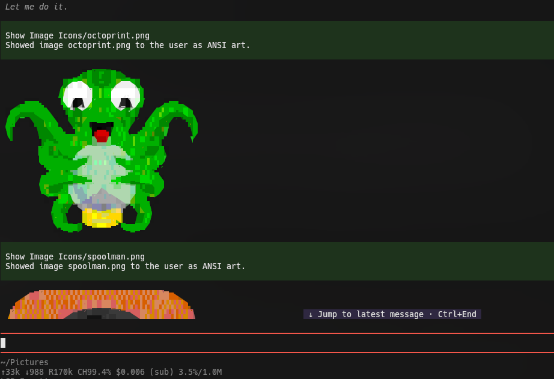

# pi-chafa

Show image files to the **user** in the pi terminal — native kitty/iTerm2 rendering where the terminal supports it, and Chafa ANSI/Unicode symbols art everywhere else (tmux, screen, Alacritty, VS Code, plain SSH, Windows consoles).

This is a **UI/UX feature, not a vision feature**: the model never receives the image contents.




## Requirements

- A pi host compatible with the peer range (see `package.json`; extensions run in pi's isolated npm root).
- A system **`chafa`** binary ≥ **1.10.0** on `PATH` (dev/test target: 1.18.x). Install: `brew install chafa` (macOS), `apt install chafa` (Debian/Ubuntu), or your distro's package. Set `CHAFA_BIN` to an explicit path if it is not on `PATH`.

## Install

```bash
pi install npm:@lordekeen/pi-chafa          # or
pi install ./path/to/pi-chafa               # local dir
pi -e ./path/to/pi-chafa/src/index.ts       # try without installing
```

The bundled `pi-chafa` skill is auto-discovered from the package `skills/` directory.

## First use

Ask the agent to show an image: "show me ~/Pictures/plot.png" — the agent calls the `show_image` tool. 

Run `/images` to tune defaults (including `timeoutMs`) and inspect the runtime environment (the **effective** protocol and which source supplied it — `getCapabilities()`, `terminal.images`, or `PI_IMAGE_PROTOCOL` — plus host `showImages`, pi-pretty read override, chafa version):
- <kbd>↑</kbd> / <kbd>↓</kbd> — Navigate settings
- <kbd>Enter</kbd> / <kbd>Space</kbd> — Cycle through presets inline (staged); on **Runtime status** it opens the runtime facts in place, with no dialog
- <kbd>e</kbd> — Open modal to type a custom value (staged)
- <kbd>Ctrl</kbd>+<kbd>S</kbd> — Save the staged changes and close (the only confirm)
- <kbd>Esc</kbd> / <kbd>q</kbd> — Discard the staged changes and close; both report `pi-chafa: settings unchanged (cancelled)` (the file stays untouched)

`/images status` prints those runtime facts as a notification and returns without opening the panel. Any other argument warns and opens the panel (`show` / `reset` are **not** implemented yet).

## Subagents and vision

Subagents declare a strict tool allowlist, so they need an explicit extension-tool selector for `show_image` — a bare `show_image` entry is parsed as a built-in name and rejected:

```yaml
# ~/.pi/agent/agents/designer.md
tools: read, grep, find, ls, write, ext:pi-chafa/show_image, ext:pi-codegraph
```

- `ext:pi-chafa/show_image` exposes just this tool; `ext:pi-chafa` exposes all of the extension's tools.
- Any `ext:` entry flips extension tools to an explicit allowlist for that agent — list every extension tool it should keep.
- Extension names are case-insensitive; tool names are case-sensitive.

Subagent sessions are headless (`ctx.hasUI === false`): `show_image` returns the plain-text summary only and nothing is rendered. The orchestrator re-invokes `show_image` at top level to actually show the user the image.

`show_image` never returns image content to the model, so **interpreting** an image requires a vision model: dispatch a vision-capable subagent (e.g. `designer`), or ask the user to run `/vision-handoff` — that extension is user-initiated and exposes no model-callable describe tool.

## Terminal matrix

| Terminal | Delivery |
|---|---|
| kitty / iTerm2 (showImages on) | native image blocks (default) |
| kitty / iTerm2 with `preferNative: false` or `format: "symbols"` | Chafa symbols (forced) |
| kitty / iTerm2 with host `showImages` off | Chafa symbols (the host would suppress image blocks) |
| `format: "native"` on kitty / iTerm2 with host `showImages` off | Chafa symbols, with a note in the result |
| `format: "native"` when the terminal is not native-capable | error (no silent fallback) |
| anything else (null protocol) | Chafa symbols |

On kitty, non-PNG images returned natively rely on pi's built-in PNG conversion; if conversion is unavailable those mimes are skipped by the host — use `format: "symbols"` there.

### Terminals with Kitty Graphics support (e.g. Konsole)

`pi` automatically detects Kitty graphics for `kitty`, `ghostty`, `wezterm`, and `warp`. Other terminals that support the Kitty graphics protocol (such as **Konsole 22.04+**) default to symbols unless you explicitly tell `pi` that Kitty graphics are supported:

1. **Environment variable** (in your shell profile):
   ```bash
   export PI_IMAGE_PROTOCOL=kitty
   ```
2. **Or in `~/.pi/agent/settings.json`**:
   ```json
   {
     "terminal": {
       "images": "kitty"
     }
   }
   ```
   *(Note: Use `"terminal": { "images": "kitty" }`. Do not use `"terminalCapabilityOverrides"`, which is an internal method name in pi).*

Either override is now honoured directly by pi-chafa, so `show_image` works even when pi's own detection cannot see the terminal.

## Config file — `~/.pi/agent/pi-chafa.json`

`version` (config schema version, default 1) plus:

| Key | Type | Default | Meaning |
|---|---|---|---|
| `preferNative` | boolean | `true` | Prefer kitty/iTerm2 whenever supported; `false` forces Chafa symbols even on native terminals. |
| `cellWidth` | integer | `60` | Chafa width in columns. Defaults from pi's `terminal.imageWidthCells` when unset here and `CHAFA_CELL_WIDTH` is unset; clamped to the live terminal width minus 2 when the viewport is narrower (a note records the clamp). |
| `maxRows` | integer | `50` | Chafa `--size` row cap for symbols output. When the cap binds, the result notes it (`output capped at maxRows=N rows`). |
| `colors` | enum | `240` | `none\|2\|8\|16\|240\|256\|full`. |
| `symbolsSet` | string | `block+border` | Chafa `--symbols` class list; classes depend on your chafa version. |
| `dither` | enum | `none` | `none\|ordered\|diffusion\|noise`. |
| `formatOrder` | array | `["symbols"]` | Reserved fallback-chain placeholder (v1 effective value). |
| `binaryPath` | string \| null | `null` | Explicit chafa path (overrides PATH). |
| `timeoutMs` | integer | `8000` | Per-invocation wall-clock bound. |

Unknown keys and invalid values are skipped silently. Copy `pi-chafa.example.json` for a commented starting point. `/images` edits this file for you.

## Environment variables

Precedence is always **tool params > `CHAFA_*` env > config file > defaults** (for `cellWidth`, pi's `terminal.imageWidthCells` fills in when all three are silent).

| Env | Maps to | Notes |
|---|---|---|
| `CHAFA_BIN` | `binaryPath` | Explicit binary path. |
| `CHAFA_CELL_WIDTH` | `cellWidth` | Integer. |
| `CHAFA_MAX_ROWS` | `maxRows` | Integer rows. |
| `CHAFA_COLORS` | `colors` | `none\|2\|8\|16\|240\|256\|full`. |
| `CHAFA_SYMBOLS` | `symbolsSet` | Symbol class list. |
| `CHAFA_DITHER` | `dither` | `none\|ordered\|diffusion\|noise`. |
| `CHAFA_PREFER_NATIVE` | `preferNative` | `1\|0` plus `true\|false\|yes\|no\|on\|off` (case-insensitive, trimmed). |
| `CHAFA_TIMEOUT_MS` | `timeoutMs` | Integer ms. |
| `CHAFA_CONFIG_DIR` | config location | Override for `pi-chafa.json`; defaults to `~/.pi/agent`. |

pi's image capability is resolved (read-only) through an explicit ladder, in priority order: an **environment guard** (#026 — terminals known to be unable to render images, i.e. Alacritty, VS Code, Zed, JetBrains, Windows Terminal, GNU screen and `win32`, always resolve to Chafa symbols; under tmux ambient declarations are ignored while `PI_IMAGE_PROTOCOL` stays an explicit opt-in) → `getCapabilities().images` → pi's settings `terminal.images` (`"kitty"`/`"iterm2"`; `false`, `"auto"`, absent, or unrecognised all mean "no override") → `PI_IMAGE_PROTOCOL` → `null` (Chafa symbols). `terminal.showImages` and `terminal.imageWidthCells` are also read; nothing in pi's settings is ever written.

## Limitations (v1)

- Animated files show a **still frame** (`--animate off`).
- Symbols width is clamped to the live terminal width (`columns - 2`) when the viewport is known; the clamp is a heuristic and cannot react to a resize that lands after rendering.
- No sixel — kitty/iTerm2 blocks and Chafa symbols are the only delivery paths; a sixel path depends on upstream pi-tui work that has not landed.
- Not a `read` override; pi-pretty's `read` may be preferable on native terminals (see the bundled skill).
- On native terminals (kitty/iTerm2), a file that is not a recognized image format is a per-file error (`format="symbols"` may still render it via Chafa) — no image block is emitted, since a host-unrenderable block would be persisted in session history and rejected by providers on every later turn.
- Native rendering depends on the terminal's own image-protocol implementation: a terminal that only *partially* implements kitty graphics can leave blank space where an image was placed — observed with Konsole 26.08 when `terminal.images` declares `"kitty"`, reproducible with pi's built-in `read`, i.e. terminal-side. Prefer `format: "symbols"` there (#032).

## Troubleshooting

- **Missing chafa** → install it (above) or set `CHAFA_BIN`.
- **Blank / wrong-color symbols** on a non-truecolor terminal → set `colors` to `16` or `8`.
- **Kitty shows a caption but no image for a JPEG/GIF/WebP** → host PNG conversion limitation; pass `format: "symbols"`.
- **Terminal supports Kitty graphics (e.g. Konsole) but renders ANSI symbols** → pi's auto-detection only recognizes `kitty`, `ghostty`, `wezterm`, and `warp`. Override via `export PI_IMAGE_PROTOCOL=kitty` or set `"terminal": { "images": "kitty" }` in `~/.pi/agent/settings.json`.
- **A declared `terminal.images` is ignored** → pi-chafa refuses declarations in terminals known to be unable to render image protocols (Alacritty, VS Code, Zed, JetBrains, Windows Terminal, GNU screen, `win32`). Under tmux only `PI_IMAGE_PROTOCOL` can force native (via kitty passthrough); `terminal.images` is deliberately ignored there because a stale declaration is what produced blank output. See #026.
- **Native images render blank on Konsole** (with `"terminal": { "images": "kitty" }` declared) → Konsole only partially implements the kitty protocol; the same blank output occurs with pi's own `read` tool, so it is terminal-side. Pass `format: "symbols"`, or remove the declaration and let pi-chafa resolve symbols by default. Not a pi-chafa defect — see #032.

## Contributing

See [CONTRIBUTING.md](CONTRIBUTING.md) for local setup, the four verification gates (plus the opt-in smoke run against a real `chafa`), and how releases are cut; [DESIGN.md](DESIGN.md) covers the architecture and the reasoning behind it.

## License

MIT — see [LICENSE](LICENSE).
